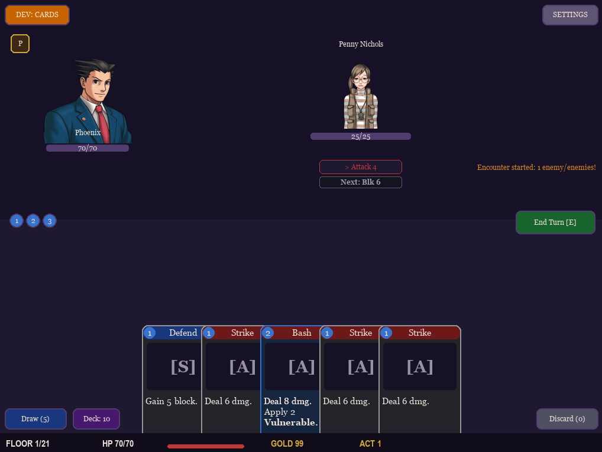
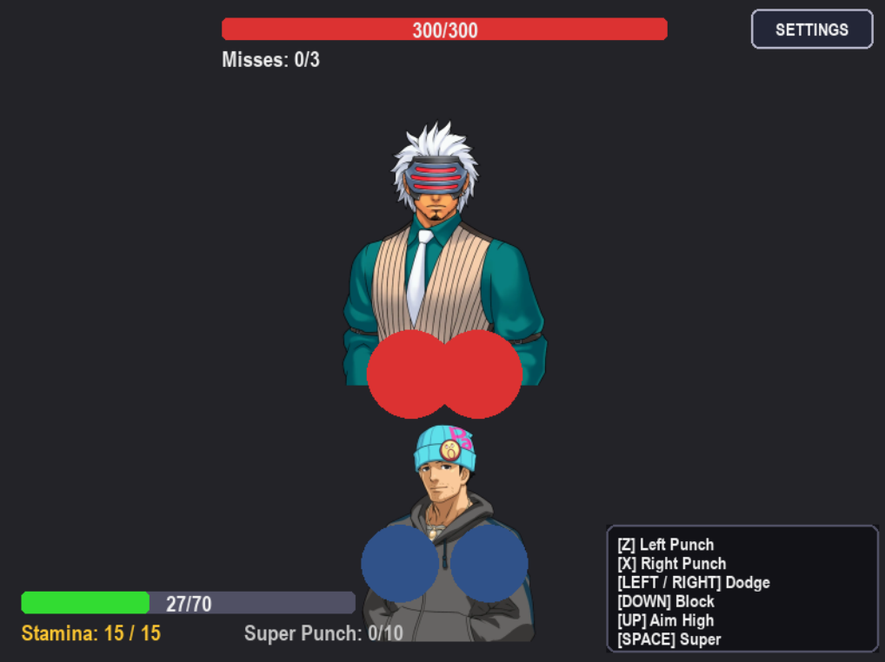
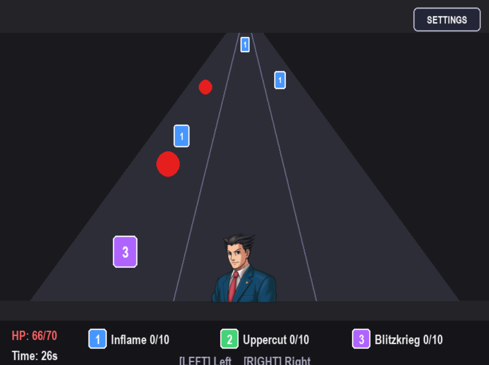
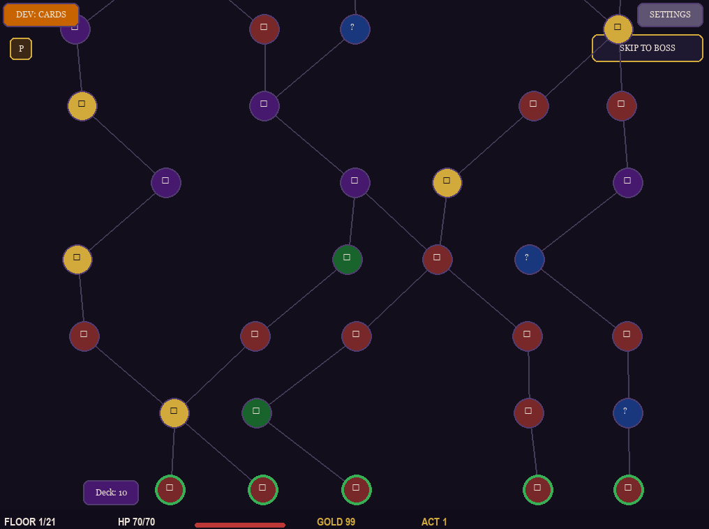

# Courtroom Battle

**Courtroom Battle** is a Python game project built with Pygame. It combines roguelike deck-building gameplay with custom mini-games, boss encounters, and a courtroom-inspired theme.

The project was developed independently as a personal software development project.

## Features

- Roguelike deck-building gameplay
- Card-based combat and game events
- Multiple mini-games
- Boss encounters
- Tutorial system
- Run history and save data
- Audio and display settings
- Custom graphical and audio assets

## Technologies

- **Python**
- **Pygame**
- **JSON** for configuration and game data

## Project Structure

- `main.py` – Main application entry point
- `game.py` – Core game logic
- `config.py` – Game configuration and card data
- `entities.py` – Game entities and UI components
- `minigame_view.py` – Mini-game display and settings
- `runner_minigame.py` – Runner mini-game
- `cupid_minigame.py` – Mini-game module
- `manpac_minigame.py` – Mini-game module
- `boxing_boss.py` – Boss encounter
- `breakout_boss.py` – Boss encounter
- `tutorial.py` – Tutorial system
- `run_history.py` – Run history functionality

## Getting Started

### Requirements

- Python
- Pygame

### Installation

1. Clone the repository:

   ```bash
   git clone https://github.com/the55lol/Courtroom-Battle.git
   ```

2. Navigate to the project directory:

   ```bash
   cd Courtroom-Battle
   ```

3. Install Pygame:

   ```bash
   pip install pygame
   ```

4. Run the game:

   ```bash
   python main.py
   ```

## Author

Independently developed by [the55lol](https://github.com/the55lol).


## Screenshots

### Gameplay


### Boss Fight


### Mini-game


### Map



